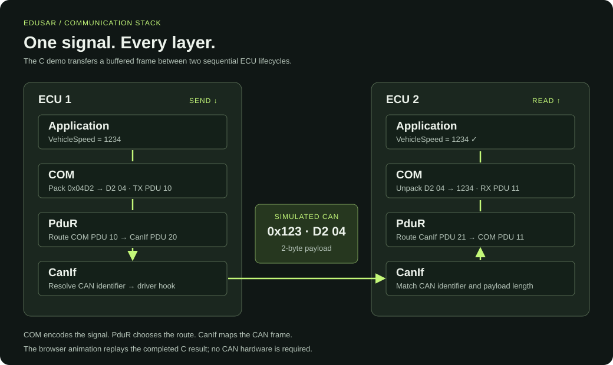

# Educational communication stack

A host-runnable C99 implementation of a small AUTOSAR-inspired communication
profile. Requires a C99 compiler, GNU Make, and Python 3 (standard library only).
No hardware, packages, or network connection are needed.



For a guided introduction and quick start, see the [project README](../../README.md).

From the repository root:

```sh
make -C PduR/build
make -C PduR/build demo
make -C PduR/build test
make -C PduR/build clean
```

The executable is `PduR/build/out/bin/demo`. Expected output:

```text
COM sends VehicleSpeed=1234
CAN TX id=0x123 data=D2 04
COM receives VehicleSpeed=1234; confirmations=1
```

## Data flow

`Com_SendSignal` packs an unsigned 16-bit value in little-endian order.
`PduR_ComTransmit` maps the COM transmit PDU to a CanIf transmit PDU.
`CanIf_Transmit` resolves its standard CAN identifier and calls the driver hook.
The demo hook buffers the frame. After transmit confirmation, the demo starts
a fresh receiver lifecycle and delivers the frame into `CanIf_RxIndication`.
CanIf matches the CAN identifier and payload length, and PduR maps the received
PDU to COM. `Com_ReceiveSignal` returns the decoded value.
A successful synchronous driver return triggers the transmit confirmation.

The driver consumes or copies the payload before returning. An `E_OK` return
means synchronous completion in this profile; it is not a hardware CAN ACK.
Initialization order in the demo is CanIf, PduR, COM. Configuration pointers must
remain valid for the entire time the modules use them. Runtime configuration
structures are trusted; use the generator to validate configuration input.
All calls run in one thread; the modules are not reentrant.

## Generate configuration

Edit `PduR/config/demo.json`, then build. The Python generator produces
`PduR/PduR/src/PduR_PBcfg.c`, containing all three modules' configuration tables.
Do not edit that file directly. To generate only:

```sh
make -C PduR/build generate
```

Each entry defines a signal name and ID, COM transmit/receive PDU IDs, CanIf
transmit/receive PDU IDs, and an 11-bit CAN identifier. The default example uses
signal 0, COM PDUs 10/11, CanIf PDUs 20/21, and CAN ID `0x123` (291).
The generator accepts 1–16 signals, validates integer ranges and names, and
rejects duplicates within each ID category. Every PDU has exactly one 16-bit
signal and a two-byte payload. IDs in different categories may overlap.

An alternate JSON file can be selected with
`make -C PduR/build CONFIG=/absolute/path/config.json`.
The demo and stack tests intentionally use the default configuration's IDs;
update the application when changing those IDs. Generation runs on each build
so changing CONFIG always updates the tables. Compiler and linker settings are
in `PduR/build/config.mk`; command-line overrides such as `CC=clang` work.

## Supported scope

COM provides immediate send, receive storage, and confirmation counting. PduR
provides one-to-one interface routing. CanIf provides synchronous transmission
and receive filtering for classic CAN with standard identifiers. Invalid send
requests return `E_NOT_OK`; invalid receive indications are ignored. Receive
signals return `E_NOT_OK` until their first valid frame or after reinitialization.

This is an educational implementation, not an AUTOSAR-conformant BSW stack.
It does not implement ARXML/ECUC, signal bit layouts, cyclic scheduling, PDU
groups, DET/DEM, transport protocols, CAN FD, controller modes, concurrency,
or an asynchronous hardware CAN driver. A hardware port would need a different
confirmation lifecycle and appropriate buffering before using queued drivers.

## Validation

`make -C PduR/build test` checks byte packing, loopback, confirmation counts,
unknown IDs, malformed lengths, null inputs, failed drivers, reinitialization,
and generator validation and deterministic multi-signal output. The default
build enables `-Wall -Wextra -Werror -pedantic`.

## Two-ECU visual demo

```sh
make -C PduR/build ui
```

Open http://127.0.0.1:8000 in your browser. Use `PORT=8080` to choose another
port. Stop the server with Ctrl+C. No browser packages or internet connection
are needed.

Enter VehicleSpeed (0–65535) and choose **Send signal**. Two ECU blocks show the
transmit path down Application → COM → PduR → CanIf, across CAN, and the receive
path up CanIf → PduR → COM → Application. Pause/resume, step, reset, and playback
pace controls let you inspect each stage. The frame inspector shows payload
bytes, sent/received values, and transmit confirmation count.

The local Python server runs the compiled C demo for every transmission. The
animation replays that completed result; it does not show real-time hardware
traffic. The C executable buffers a frame between two sequential module
lifecycles, using fresh receive state for ECU 2. Both lifecycles use the same
generated configuration. The diagram uses the default demo's signal and PDU IDs.
The modules still use singleton state, so this is not two concurrent ECU stacks.

`PduR/build/out/bin/demo --json 1234` exposes the same machine-readable result.
After building, run `python3 PduR/tests/test_ui.py` for the HTTP/C bridge
integration check (requires permission to bind a localhost socket).
